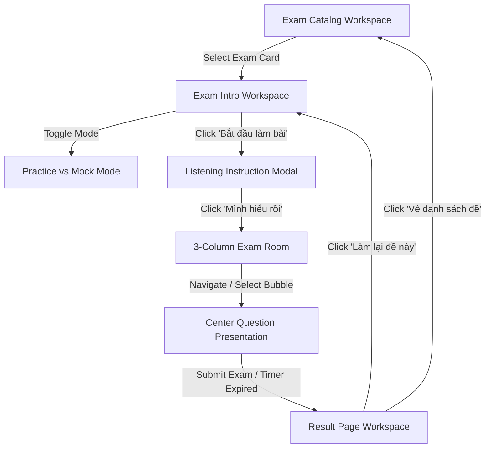

# HSK UI V14 — SCREEN MAP & USER FLOWS

## 1. Top-Level Flow Diagram

---

## 2. Screen Detail Specifications

### Screen 1: Exam Catalog (`ExamCatalogWorkspaceView`)
- **Header**:
  - HSK Level Dropdown (`HSK 1` to `HSK 7-9`).
  - Top Tabs:
    - *Đề mô phỏng* (with progress badge, e.g. `3/10`).
    - *Đề kỹ năng* (with total count badge).
    - *Đề nâng cao* (with total count badge).
- **Filter Bar**:
  - Search input with clear button and magnifying glass icon.
  - Status filter dropdown (`Tất cả`, `Chưa làm bài`, `Đang làm dở`, `Đã hoàn thành`).
- **Card Grid**: 4-column responsive grid displaying `ExamCatalogCard` items with cover graphic, duration, question count, and status badge.

### Screen 2: Exam Intro (`ExamIntroWorkspaceView`)
- **Breadcrumb / Back**: Top-left back button returning to catalog.
- **Card Header**: HSK level badge and exam title.
- **Skills Distribution Box**: Split container showing question counts per skill (Nghe: 20 câu, Đọc: 20 câu).
- **Exam Meta**: Duration (35 phút), Passing score (120/200 điểm).
- **Mode Selector**: Toggle switch between *Luyện tập* (Practice) and *Thi thử* (Mock Exam).
  - Practice mode shows blue notice callout: allows audio pause and instant explanations.
  - Mock mode shows warning notice: strict timer, locked pause, explanations deferred to result page.
- **CTA**: Full-width "Bắt đầu làm bài" button.

### Screen 3: Listening Instructions Modal (`ListeningInstructionModal`)
- Modal overlay with backdrop blur.
- Centered audio mascot icon.
- Overview title and subtext.
- Breakdown table: Part Number, Title (Đúng hay Sai, Chọn ảnh, Ghép ảnh, Hội thoại ngắn), and Question Count.
- Action row: "Kiểm tra âm thanh" (optional sound test) and "Mình hiểu rồi" (confirm and proceed).

### Screen 4: 3-Column Exam Room (`ExamRoomWorkspaceView`)
- **Sticky Top Bar**: Back button, Brand logo, Exam title, Mode pill badge.
- **Column 1 (Left - 250px)**: `ExamNavigator` with skill tabs (Nghe, Đọc), parts list, and numbered question bubbles with reactive states (`current`, `answered`, `unanswered`, `correct`, `incorrect`).
- **Column 2 (Center - 1fr)**: Question Presentation (`ListeningTrueFalse`, `ListeningImageChoice`, `ListeningMatching`, `ListeningDialogue`, `ReadingPassageQuestion`, `WritingWorkspaceV14`), accompanied by `ExplanationAccordion` and footer navigation buttons.
- **Column 3 (Right - 270px)**: `ExamTimerCard` with dual-segment digital countdown clock (`DigitalTimer`), pause indicator, and large "Nộp bài" CTA.
- **Mobile Viewport**: Navigator collapses into an accessible slide-over drawer triggered by a top-bar "📋 Câu hỏi" button; timer stays pinned to sticky header.

### Screen 5: Exam Result Page (`ResultWorkspaceViewV14`)
- **Score Hero**: Accuracy percentage (`85%`), Pass/Fail status badge, final score vs passing score, time elapsed.
- **4-Stat Breakdown**: Quick counter cards for Đúng (green), Chưa đúng (red), Bỏ trống (gray), Chờ chấm (amber).
- **Skill Progress**: Visual progress bars showing accuracy percentage for Listening and Reading.
- **Question Review List**: Filterable by All, Incorrect, or Correct. Each question item expands into the 4-tab `ExplanationAccordion`.
